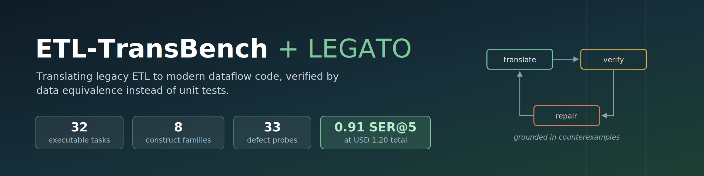
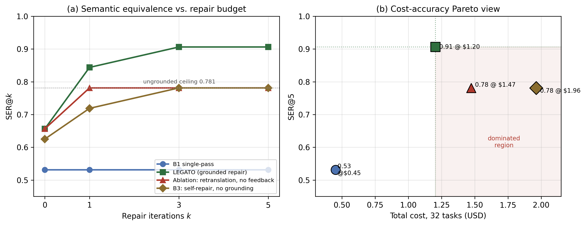

<p align="center">
  
</p>

<p align="center">
  <a href="https://github.com/akshaysharma1088/etl-transbench/actions/workflows/tests.yml">
    </a>
  <a href="LICENSE"></a>
  
  
  
  
</p>

<p align="center">
  <b>A public benchmark and an agentic framework for translating legacy ETL workflows into modern
  dataflow code, verified by data equivalence rather than by unit tests.</b>
</p>

<p align="center">
  <a href="#why-this-exists">Why</a> &nbsp;·&nbsp;
  <a href="#headline-result">Results</a> &nbsp;·&nbsp;
  <a href="#quickstart">Quickstart</a> &nbsp;·&nbsp;
  <a href="#reproducing-the-papers-results">Reproduce</a> &nbsp;·&nbsp;
  <a href="#benchmark-structure">Benchmark</a> &nbsp;·&nbsp;
  <a href="CONTRIBUTING.md">Add a task</a>
</p>

---

> Companion artifact for the manuscript *"LEGATO: Agentic Large Language Model Translation of
> Legacy ETL Workflows to Modern Dataflow Code with Test-Based Semantic Verification."*

## Why this exists

Enterprises are migrating enormous inventories of legacy ETL jobs to Spark and lakehouse platforms, and LLMs are now the default tool for the job. But there is no public benchmark for it. Academic code-translation suites evaluate single functions or single SQL statements; ETL programs thread state across steps, maintain dimension history, route rejects, and must be idempotent under replay. None of that is visible in one statement.

Correctness here is also not a unit test. It is whether the translated pipeline produces **the same data** as the legacy one, under declared tolerances for row order, float precision, null semantics, and type coercion.

This repo provides both halves: a benchmark where the legacy program is executable as an oracle, and a reference agent that repairs translations using counterexamples from differential execution.

## Headline result

32 tasks, 4 configurations, measured 26 July 2026. Models pinned to `claude-haiku-4-5-20251001` (cheap tier) and `claude-sonnet-5` (frontier tier). Full evaluation cost USD 5.09.

| Configuration | SER@0 | SER@1 | SER@3 | SER@5 | Solved | Cost (USD) |
|---|---|---|---|---|---|---|
| B1 single-pass | 0.531 | 0.531 | 0.531 | 0.531 | 17/32 | 0.453 |
| **LEGATO (grounded repair)** | 0.656 | 0.844 | **0.906** | **0.906** | **29/32** | **1.205** |
| Ablation (retranslation, no feedback) | 0.656 | 0.781 | 0.781 | 0.781 | 25/32 | 1.473 |
| B3 (self-repair, no grounding) | 0.625 | 0.719 | 0.781 | 0.781 | 25/32 | 1.963 |

SER@k is the fraction of tasks verified semantically equivalent within k repair iterations.

Two things worth noticing. Grounded repair is both the **most accurate and the cheapest** of the three repair strategies, so there is no trade-off to negotiate. And the two ungrounded strategies, retranslating with a stronger model and asking the model to critique itself, converge on **exactly the same ceiling** of 0.781 despite being structurally unrelated. What separates LEGATO from both is the presence of an external counterexample in the repair prompt, not the model tier and not the number of attempts.

The gap lives almost entirely in dimension-history semantics (category T5), where LEGATO solves 4 of 4 and both ungrounded configurations solve 1 of 4. A history defect is a silent value divergence: the code runs and emits a plausible table with the wrong rows in it. There is no error to read, so self-critique has nothing to work with.

<p align="center">
  
</p>

<p align="center"><sub>Left: both ungrounded strategies converge on the same 0.781 ceiling.
Right: the region dominated by LEGATO, better <i>and</i> cheaper, is shaded.</sub></p>

Raw per-task results, including cost and iteration counts for all 128 task runs, are in [`results/run-2026-07-26/`](results/run-2026-07-26/).

## Quickstart

```bash
git clone https://github.com/akshaysharma1088/etl-transbench.git
cd etl-transbench
pip install -r requirements.txt
```

Verify the benchmark itself. No API key needed, no cost:

```bash
python tests/test_harness.py           # equivalence checker + diagnoser
python tests/test_full_benchmark.py    # all 32 oracles, bug probes, perturbation
python tests/test_t1_variants.py       # per-category defect probes
```

Every task ships with at least one **planted defect** and a test asserting the harness catches it. That is how the benchmark validates itself: an equivalence checker that passes a known-wrong translation is not measuring anything. The suite currently contains 33 such probes, all caught.

Exercise the agent loop with a scripted stand-in model, still no cost:

```bash
python experiments/run_experiments.py --mock --limit 3 --out /tmp/mock
```

## Reproducing the paper's results

```bash
export ANTHROPIC_API_KEY=sk-ant-...

python experiments/run_experiments.py \
  --cheap claude-haiku-4-5-20251001 \
  --frontier claude-sonnet-5 \
  --out results/my-run
```

Roughly USD 5 and 50 minutes for all four configurations over 32 tasks.

Useful flags:

| Flag | Purpose |
|---|---|
| `--configs 2,4` | Run only selected configurations. Results are assembled from all partials on disk, so interrupted runs resume without re-spending. |
| `--tasks t1c_teradata_intdiv,t4b_delete_reinsert` | Run a named subset. Writes to `*_subset.*` files so a partial run can never contaminate a full-benchmark result. |
| `--limit N` | First N tasks only, for smoke tests. |
| `--mock` | Scripted model, no API calls. |

Each configuration writes its partial as soon as it completes, so a failure late in the run does not lose earlier work.

**Expect run-to-run variation of about one task.** LLM sampling is stochastic. We executed the retranslation ablation twice and got 24 and 25 of 32; the three repair configurations share an identical initial-translation policy yet reported SER@0 of 0.656, 0.656, and 0.625. Your numbers will not match ours exactly, and single runs should not be compared at a resolution finer than about 0.03 SER.

## Benchmark structure

Eight categories of legacy construct, four distinct tasks each. Within a category the four tasks are different constructs, not parameter variants.

| ID | Category | Primary hazard |
|---|---|---|
| T1 | Dialect SQL semantics | Silent drift in null and type handling |
| T2 | Procedural and cursor state | Control flow to set-oriented rewrite |
| T3 | Graphical dataflow graphs | Implicit component semantics |
| T4 | Multi-step job interaction | State threading across steps |
| T5 | History and SCD semantics | Merge correctness over versions |
| T6 | Sessionization | Frame and ordering semantics |
| T7 | Validation and reject paths | Error-path equivalence |
| T8 | CDC and incremental merge | Exactly-once and replay semantics |

Each task directory contains:

```
tasks/<task_id>/
  legacy_artifact.{sql,txt,json}   the legacy program
  reference.py                     executable oracle for the legacy semantics
  spec.json                        equivalence spec: keys, tolerances, ordering
  generator.py                     seeded adversarial input generator
  task.json                        metadata: category, tier, description
```

### On adversarial generation

The generators are the part that matters most, and the reason is empirical. During development, a translation that dropped a window tie-breaking column **passed on every randomly generated corpus**, because random timestamps essentially never tie within a partition. It failed on every seed once within-key ties were deliberately injected. The same pattern recurred twice more: a stable sort hides a missing cursor tie-break unless physical row order is shuffled, and a watermark off-by-one is invisible without events landing exactly on the boundary.

Discriminating power comes from engineered cases, not data volume. Production-shaped data is *worse* than random for this purpose, not better.

## Adding a task

See [CONTRIBUTING.md](CONTRIBUTING.md). The short version: write the legacy artifact and an executable oracle, declare the equivalence spec, write a generator that guarantees the discriminating cases rather than sampling them, then add a test that plants the classic migration bug for that construct and asserts the harness catches it. A task without a passing defect probe is not accepted.

## Known limitations

<details open>
<summary>Stated plainly, because they bound what conclusions the results support. (click to collapse)</summary>

- **Test equivalence is not proof.** Passing all corpora does not establish semantic equivalence, only that no engineered case distinguished the programs. This is the same standard used to accept human-performed migrations, applied more systematically.
- **Three categories are saturated.** T3, T7, and T8 are solved by every configuration including single-pass, so they contribute no discriminating power. T5 currently carries a disproportionate share of it.
- **Single run per configuration.** See the variance note above.
- **Thirty-two base tasks is small.** The perturbation harness multiplies the evaluation surface but adds no independent semantics; do not count perturbed instances as independent tasks.
- **One model family, one target dialect.** PySpark over Spark SQL, Claude models. Generalization is untested.
- **Three tasks are unsolved by everything.** Teradata integer division, partition delete-and-reinsert, and the stale-snapshot delta. In each, the differential evidence is correct but under-determines the fix. We call this diagnostic under-determination and consider it the open problem.

</details>

## Citation

See [CITATION.cff](CITATION.cff). Update the DOI once the paper is published.

## License

MIT. See [LICENSE](LICENSE).
